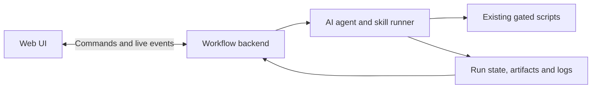

# Plan: web UI for the AI firmware workflow

## Objective

Provide a web UI that lets a developer guide an end-to-end AI firmware workflow, see operation
states, review generated artifacts, inspect live logs, and respond to developer-action gates.
Use the existing skill scripts as execution providers and the sibling lifecycle project's phase
contracts where applicable. Keep lifecycle phases and provider engineering milestones distinct.

This plan follows the [M0 study](m0-study.md). It is a proposed implementation sequence; no UI
implementation or firmware execution is claimed by this document.

> **Status 2026-11-18:** a first version of this UI was built in the sibling project
> [firmware-dev-life-cycle](https://github.com/vsupacha/firmware-dev-life-cycle) as its **Auto** and **IDE**
> pages (provider manifests, run records, stage runner, approval bound to the image hash). This plan is
> kept as the original proposal.

## Architecture

The browser presents durable backend state. Long operations run in a worker and continue when
the browser disconnects. The backend validates commands and approvals, while the skill scripts
retain their identity, build, flash and test gates. An AI response alone cannot mark a script gate
as passed.

## UI scope

| Area | Contents |
| --- | --- |
| Workflow overview | Requirement, Design, Code generation, Build, Deploy/Flash and Test; state and gate outcomes per operation |
| Operation details | Current action, platform, board, skill, timestamps, elapsed time, blocker and required developer action |
| Artifact browser | Requirements, architecture, generated source, diffs, firmware, manifests and reports; producing operation and revision |
| Logs | Live AI activity and script output, filtered by phase, operation and severity; downloadable raw logs |
| Action panel | Contextual approve, choose, retry, cancel and resume controls when supported by the operation |

Operation states: `queued`, `running`, `waiting_for_user`, `passed`, `failed`, `skipped`,
`cancelled`. Record generated, built, flashed/deployed, booted/running, tested and human-observed
evidence separately. A skipped check must remain visible.

## Backend contract

- Give every project, run, operation, event, approval and artifact a stable ID.
- Pin the selected provider, skill, board profile and source revision to each run.
- Persist state transitions and structured events alongside raw process output. Use ordered event
  cursors so Server-Sent Events can reconnect without losing or duplicating displayed entries.
- Record operation inputs, gate result, process exit code, timestamps and evidence references.
- Record each artifact's producing operation, relative path, media type, revision and content hash.
  Serve files only from registered project/artifact locations.
- Convert provider `ACTION:` output into a typed pending action. Preserve the original message.
  Bind write approval to the operation, board identity and exact artifact hash; invalidate it when
  any of those change.
- Preserve provider board locks and serial-port ownership. A retry creates a new attempt linked
  to the previous one; it must not silently repeat a flash or another approved write.
- Cancel at a safe provider boundary. After a worker crash, reconcile process state and evidence
  before resuming; do not assume an interrupted operation succeeded.
- Start locally. Keep secrets and per-PC bench identity out of exported artifacts and committed
  project metadata.

## Implementation milestones

| Milestone | Work | Acceptance criteria |
| --- | --- | --- |
| M0: contract and target selection | Use the study to select one provider; define state/event/artifact/approval records and mock run fixtures | Each UI state has a defined backend meaning; scope and provider entrypoints are documented |
| UI1: read-only run viewer | Build overview, operation details, artifacts and log views against fixtures | A developer can identify current work, blockers, artifact provenance and failures without reading chat history |
| UI2: durable execution | Add persistent run storage, worker, provider adapter and SSE updates | A real create → build run survives browser refresh/disconnect; script gate lines and raw logs remain inspectable |
| UI3: developer actions | Implement typed ACTION handling, exact-input approval, retry and safe cancellation | A pending approval is visible; changed board/image invalidates approval; retry preserves previous evidence |
| UI4: evidence and recovery | Add artifact hashes/diffs, log export, interrupted-run recovery and evidence-level reporting | Reopening a run restores state; artifacts trace to their producing operation; interrupted work cannot appear passed |
| UI5: lifecycle and platforms | Integrate Requirement/Design handoffs and additional FreeRTOS, RT-Thread and UNO Q adapters | Provider differences remain explicit; the same UI can explain each provider's own gates and evidence |

The UI milestone names are independent of the providers' M1–M5 capability flags. Implementing
this UI does not enable an inactive firmware milestone.

## First POC

Use one bare-metal provider, initially the Pico 2 W PlatformIO skill proposed by the M0 study.
Create an app from an existing template, build through the provider script, and display source,
manifest, firmware and raw build logs. Tool and template availability must be confirmed first.

Demonstrate the approval interaction using a clearly labelled simulated pending action. A real
flash is a separate hardware step subject to the selected skill's approval and identity gates.

POC completion requires:

1. One actual provider-generated app and a recorded build outcome, including failures if setup
   blocks progress; fixture-only demonstrations are labelled separately.
2. Live operation state and logs, plus durable restoration after a browser reconnect.
3. Artifact links with producing operation and hash, with unavailable outputs clearly identified.
4. A pending developer action that cannot proceed without an explicit, matching response.
5. A concise run report distinguishing creation, build and any later hardware evidence.

## Verification and open choices

Verify event ordering/reconnection, state transitions, approval invalidation, artifact path
boundaries, worker interruption and provider gate parsing. Exercise one real create/build path
when tools permit; add hardware verification only for the stages actually executed.

Before implementation, choose whether this UI extends the sibling `firmware-dev-life-cycle`
Requirement prototype or lives in a dedicated application project. That project already owns
lifecycle contracts and a local Requirement UI, so assess its reuse before creating a second
controller. Select the frontend, backend and storage after inspecting that implementation.

The M0 session encountered a Windows Bash service access error before the tool-check script
started. Resolve the executable/environment selection and rerun the read-only provider tool check
before claiming the real execution path is available.
